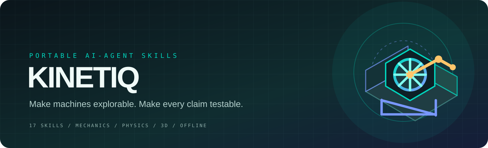
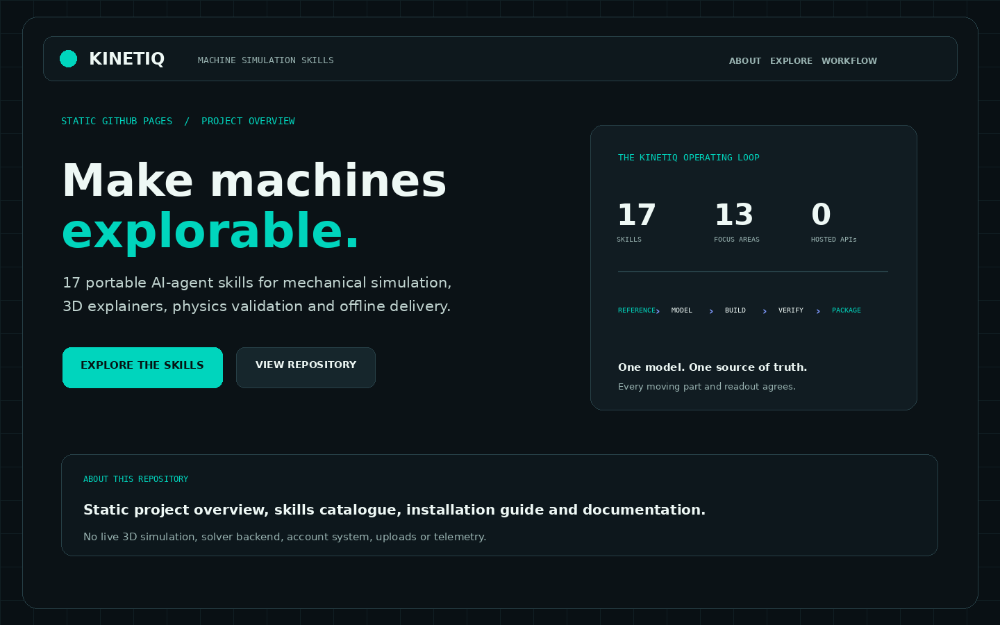
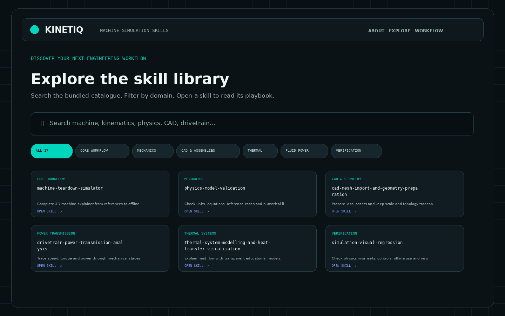
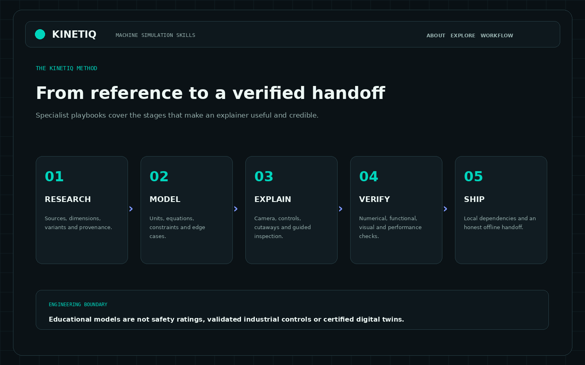

<div align="center">



# KINETIQ Machine Simulation Skills

### Make machines explorable. Make every claim testable.

**17 portable AI-agent skills for interactive 3D machine explainers, mechanical simulation, physics validation, and offline delivery.**

[](https://github.com/voyager67/KINETIQ-Machine-Simulation-Skills/stargazers)
[](LICENSE)
[](catalog.json)
[](scripts/validate.py)
[](docs/OFFLINE-AND-SAFETY.md)

[**Open the static GitHub Pages site**](site/index.html) · [Quick start](#-quick-start) · [Install across agents](#-install-for-your-ai-agent) · [Browse all skills](#-the-17-skill-library) · [Contributing](CONTRIBUTING.md)

</div>

---

## The idea

A machine is easier to understand when you can watch it move, change its input, open the assembly, isolate a subsystem, and inspect the numbers behind the motion. KINETIQ gives AI agents a repeatable method for creating that experience—without confusing a polished animation with validated engineering.

The collection follows one central rule:

> **One physical model. One source of truth. Every moving part and every readout agrees.**

KINETIQ is a library of portable `SKILL.md` playbooks, not a hosted simulator service or an autonomous agent. The main skill guides an AI agent through a complete machine-explainer workflow. The other skills cover the specialist work that makes the result credible: reference reconstruction, kinematics, physics checks, interaction design, capture, regression testing, offline packaging, visualization, and performance.

## At a glance

| Included | Details |
|---|---|
| **17 focused skills** | One master workflow plus 16 specialist playbooks |
| **Cross-agent format** | Plain Markdown `SKILL.md` files with minimal YAML frontmatter |
| **Install helper** | Python standard library; installs into common project skill directories |
| **Interactive explorer** | Search, category filters, full-skill preview, copy prompt, copy skill text |
| **Templates** | Model brief, verification checklist, part/parameter register, animation timeline |
| **Quality checks** | Metadata, links, catalogue sync, mirror sync, repository-wide credential/contact scan, unit tests |
| **Offline-first** | No runtime APIs, telemetry, analytics, CDN scripts, or external font dependency |
| **License** | CC BY-NC-ND 4.0 for original KINETIQ materials, subject to file-specific and third-party notices |

## ✨ Why KINETIQ

| A typical visual demo | A KINETIQ workflow |
|---|---|
| Parts move because they were keyframed | Motion derives from an explicit model input and constraints |
| Gauges look convincing | Readouts come from the same state as the geometry |
| Dimensions are guessed | Sources, units, assumptions, and confidence are recorded |
| One screenshot looks good | Numerical checks, interaction tests, and visual review are separate gates |
| Requires a hosted viewer | Final deliverable is designed for local/offline use |
| Claims to be a digital twin | States exactly what was measured, modelled, inferred, and left unvalidated |

## 🚀 Quick start

### 1. Download and extract

Download the ZIP from the repository or extract this package. No release download or account is required for local use.

### 2. Validate the skill library

Requirements: Python 3.10 or newer. No third-party Python dependencies.

```bash
python scripts/validate.py
python -B -m unittest discover -s tests -v
```

### 3. Install selected skills

For a Codex project:

```bash
python scripts/install.py --target /path/to/your/project --agent codex \
  --skills machine-teardown-simulator,mechanism-kinematics-and-linkage-solving,physics-model-validation
```

For Claude Code:

```bash
python scripts/install.py --target /path/to/your/project --agent claude-code
```

Preview the exact files first with `--dry-run`. The installer skips an existing skill by default and never deletes an existing skill folder. Use `--overwrite` only when you deliberately want to replace the selected `SKILL.md` files.

### 4. Open the interactive explorer

```bash
python -m http.server 8765 --directory site
```

Open `http://127.0.0.1:8765`. Search by task, browse categories, preview a full skill, and copy either the skill text or an invocation prompt. The explorer is static HTML/CSS/JavaScript; it has no backend.

## 🧭 Install for your AI agent

The skill content is the same across platforms. What changes is the folder where each agent discovers skills. KINETIQ includes a small installer that copies the canonical `skills/` folders into the selected host's project-level skill directory.

| Agent | Project skill directory | Installer flag |
|---|---|---|
| OpenAI Codex | `.agents/skills/` | `codex` |
| Gemini CLI | `.gemini/skills/` (or shared `.agents/skills/`) | `gemini-cli` |
| Claude Code | `.claude/skills/` | `claude-code` |
| GitHub Copilot / VS Code | `.github/skills/` | `github-copilot` |
| Cursor | `.cursor/skills/` | `cursor` |
| OpenCode | `.opencode/skills/` | `opencode` |
| Windsurf | `.windsurf/skills/` | `windsurf` |
| Multiple listed hosts | All above | `all` |

Examples:

```bash
# Install every KINETIQ skill for Codex in the current project
python scripts/install.py --target . --agent codex

# Install only the main workflow and physics checks for Claude Code
python scripts/install.py --target . --agent claude-code \
  --skills machine-teardown-simulator,physics-model-validation

# Install to several supported folders in one project
python scripts/install.py --target . --agent all --dry-run
```

For an agent not listed above, use its documented skill directory or attach the relevant `SKILL.md` file as project knowledge/instructions. A host must actually support reading Agent Skills or supplied Markdown; no repository can force every AI product to auto-discover the same folder. See [Cross-agent portability](docs/CROSS-AGENT-PORTABILITY.md).

## 🧠 The 17-skill library

| Skill | Domain | Purpose |
|---|---|---|
| [`machine-teardown-simulator`](skills/machine-teardown-simulator/SKILL.md) | Core workflow | Orchestrate a complete interactive 3D machine explainer from references to offline handoff. |
| [`engineering-reference-reconstruction`](skills/engineering-reference-reconstruction/SKILL.md) | Research | Reconstruct geometry and operating behavior with traceable sources and confidence. |
| [`mechanism-kinematics-and-linkage-solving`](skills/mechanism-kinematics-and-linkage-solving/SKILL.md) | Mechanics | Solve linkages, gears, cams, joints, and constrained motion. |
| [`physics-model-validation`](skills/physics-model-validation/SKILL.md) | Mechanics | Check equations, units, reference cases, uncertainty, and model limits. |
| [`interactive-3d-explainer-design`](skills/interactive-3d-explainer-design/SKILL.md) | 3D design | Design camera views, part selection, cutaways, and accessible 3D learning flows. |
| [`simulation-controls-and-subsystem-inspection`](skills/simulation-controls-and-subsystem-inspection/SKILL.md) | Interaction | Design reversible controls, isolation, exploded states, and guided inspection. |
| [`timeline-driven-animation-capture`](skills/timeline-driven-animation-capture/SKILL.md) | Capture | Keep machine state, camera, labels, and optional sound synchronized in deterministic capture. |
| [`simulation-visual-regression`](skills/simulation-visual-regression/SKILL.md) | Verification | Test physical invariants, controls, representative captures, offline behavior, and visual changes. |
| [`offline-simulator-packaging`](skills/offline-simulator-packaging/SKILL.md) | Delivery | Bundle dependencies and produce a clean, portable offline deliverable. |
| [`scientific-visualization-storytelling`](skills/scientific-visualization-storytelling/SKILL.md) | Data | Visualize simulation and experimental data with honest units, scales, and uncertainty. |
| [`low-end-3d-performance-tuning`](skills/low-end-3d-performance-tuning/SKILL.md) | Performance | Optimize for integrated GPUs and modest devices without changing physical model behavior. |
| [`cad-mesh-import-and-geometry-preparation`](skills/cad-mesh-import-and-geometry-preparation/SKILL.md) | CAD & geometry | Prepare local CAD/mesh assets, verify scale and topology, and create traceable display derivatives. |
| [`assembly-coordinate-frames-and-joint-authoring`](skills/assembly-coordinate-frames-and-joint-authoring/SKILL.md) | Assemblies & constraints | Author coordinate frames, joints, degrees of freedom, and consistent assembly constraints. |
| [`drivetrain-power-transmission-analysis`](skills/drivetrain-power-transmission-analysis/SKILL.md) | Power transmission | Trace speed, torque, direction, and power through gears, belts, chains, and shafts. |
| [`fluid-power-system-visualization`](skills/fluid-power-system-visualization/SKILL.md) | Fluid systems | Explain hydraulic and pneumatic circuits with bounded, honest model fidelity. |
| [`thermal-system-modelling-and-heat-transfer-visualization`](skills/thermal-system-modelling-and-heat-transfer-visualization/SKILL.md) | Thermal systems | Model heat flow and temperature trends using transparent educational energy balances. |
| [`parameter-uncertainty-and-sensitivity-analysis`](skills/parameter-uncertainty-and-sensitivity-analysis/SKILL.md) | Uncertainty & sensitivity | Quantify how uncertain inputs change model outputs and prioritize useful measurements. |

## 🧩 Suggested workflow

```text
Reference material
      ↓
engineering-reference-reconstruction
      ↓
cad-mesh-import-and-geometry-preparation
      ↓
machine-teardown-simulator + assembly-coordinate-frames-and-joint-authoring
      ↓
mechanism-kinematics-and-linkage-solving + physics-model-validation
      ↓
Optional domains: drivetrain | fluid power | thermal model
      ↓
parameter-uncertainty-and-sensitivity-analysis (when inputs are uncertain)
      ↓
interactive-3d-explainer-design + simulation-controls-and-subsystem-inspection
      ↓
timeline-driven-animation-capture
      ↓
simulation-visual-regression + low-end-3d-performance-tuning
      ↓
offline-simulator-packaging
```

This is a suggested route, not a mandatory chain. Pick only the skills the task needs. A simple machine may not need a full video workflow; a conceptual 3D model may not need a numerical solver.

## 📁 Repository structure

```text
kinetiq-machine-simulation-skills/
├── skills/                 # 17 canonical, portable SKILL.md playbooks
├── templates/              # Model brief, checklist, parameters, timeline
├── scripts/                # Safe installer and standard-library validator
├── tests/                  # Unit tests for catalogue and installer behavior
├── docs/                   # Architecture, portability, workflow, and safety
├── site/                   # GitHub Pages static About page + catalogue + skill previews
├── assets/                 # Brand graphics, page previews, and short walkthrough video
├── catalog.json            # Machine-readable index
├── machinekit.json         # Project metadata
├── NOTICE.md               # Teardown inspiration and provenance notice
└── LICENSE                 # CC BY-NC-ND 4.0 notice for original materials
```

## 🛡️ Safety, privacy, and engineering boundaries

- No API keys, tokens, credentials, analytics, telemetry, or hosted backend are required.
- The installer writes only into the requested target and selected skill folder; existing skills are skipped by default.
- Skill files are instructions. Review them before allowing an agent to act on a trusted codebase.
- The simulator is educational unless validated against appropriate measurements and reviewed by a qualified engineer.
- Reference images, CAD exports, and manuals may have copyright or redistribution restrictions. Record provenance and reuse permissions.
- Never include private machine data, proprietary drawings, or user files in a public simulator package without authorization.

See [Offline and safety guide](docs/OFFLINE-AND-SAFETY.md) and [Security policy](SECURITY.md).

## 🧪 Verify the project

```bash
python scripts/validate.py
python -B -m unittest discover -s tests -v
python -m http.server 8765 --directory site
```

The validator checks all skill frontmatter, required sections, related-skill references, source/site mirror parity, catalogue consistency, and credential, contact-detail, and machine-specific path patterns across repository text. It also rejects sensitive file types and unexpected external network-capable code in the static explorer. The tests check installation behavior and non-destructive defaults. These checks validate the repository package, not the physical correctness of any simulator that an agent later builds.

## 🌐 GitHub Pages: the static KINETIQ project page

The GitHub Pages entry point is [`site/index.html`](site/index.html). It is a static About page and skill explorer: it introduces KINETIQ, explains the workflow and boundaries, links to repository documentation, and browses the bundled skill catalogue. It does **not** host a live 3D simulator, run engineering calculations, accept uploads, or expose a backend/API. The catalogue and skill previews are ordinary files served from the same `site/` folder.

The included GitHub Actions workflow deploys only `site/` when the workflow runs on the `main` branch or is started manually. GitHub Pages must use **GitHub Actions** as its build and deployment source. For local preview, run `python -m http.server 8765 --directory site` and open `http://127.0.0.1:8765`.

## 🖼️ Visual previews and video tour

These visual previews show the layout and content of the static project page—not photographs of a running machine or a live simulator. The animated walkthrough is a short tour of the static site; the MP4 is included as a separate file.

<p align="center">
  
</p>

<p align="center">
  
</p>

<p align="center">
  
</p>

<p align="center">
  
</p>

[Open the MP4 static-site walkthrough](assets/kinetiq-static-pages-tour.mp4).


## 🧾 Inspiration and attribution

The direction was inspired by [`elvarofficial/teardown`](https://github.com/elvarofficial/teardown), an MIT-licensed skill project. KINETIQ's files and content are independently written; no upstream source files, runtime, graphics, examples, or sounds are included. See [NOTICE.md](NOTICE.md).

---

<div align="center">

**KINETIQ · Understand the mechanism. Verify the model. Make it explorable.**

Created by Harsh Singh · [GitHub](https://github.com/voyager67)

</div>
